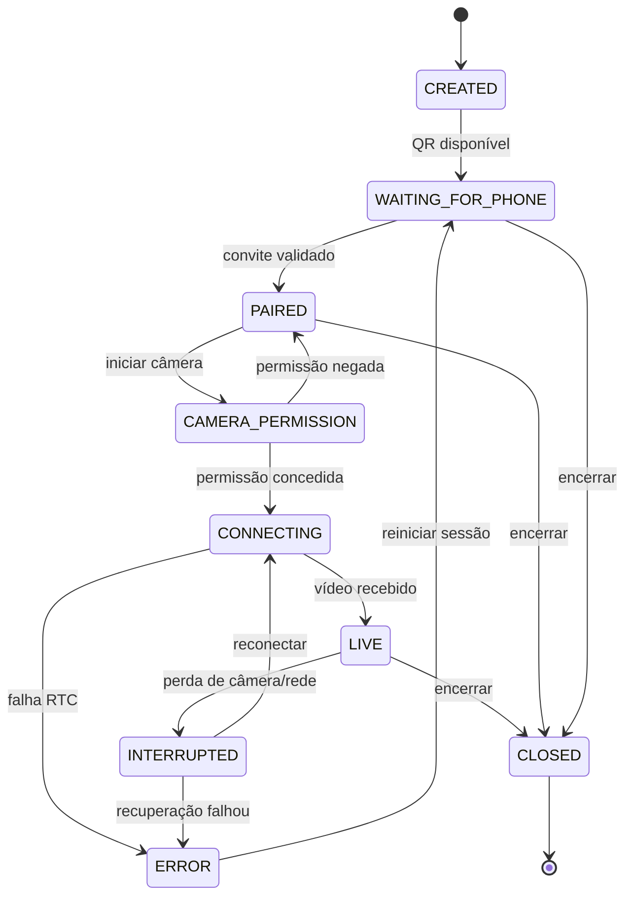
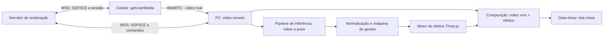

# REALITY BENDER — Especificação de Requisitos de Software (ERS)

**Versão:** 1.0  
**Data:** 03/11/2026  
**Estado:** Baseline de implementação  
**Prazo de engenharia:** 2 dias com Codex  
**Plataforma:** Navegador do celular + navegador do PC conectado a um data-show  
**Idioma da interface:** português brasileiro  
**Critério dominante:** interatividade audiovisual *real*, em tempo real, sem mídia pré-gravada

---

## 1. Visão do produto

O REALITY BENDER é uma aplicação web para apresentações e instalações interativas. A câmera do celular captura uma pessoa ao vivo e transmite o vídeo para um computador. O computador detecta pontos das mãos e do corpo, calcula a posição de elementos virtuais e compõe, sobre o vídeo ao vivo, três efeitos cinematográficos controlados pela movimentação da pessoa: **esfera de energia**, **portal dimensional** e **aura elétrica**. O computador mostra o resultado em tela cheia no data-show.

**Resultado observável esperado:** ao movimentar as mãos ou o corpo, o efeito acompanha o movimento com atraso suficientemente pequeno para parecer parte da cena. A transmissão não pode ser substituída por uma animação demonstrativa.

### 1.1 Objetivos de negócio e experiência

- **OBJ-01 — Impacto visual:** produzir três efeitos distintos, reconhecíveis e de alto contraste, visíveis em uma projeção de sala de aula ou auditório.
- **OBJ-02 — Interação contínua:** relacionar posição, escala, orientação ou intensidade do efeito à posição corporal a cada atualização de rastreamento.
- **OBJ-03 — Operação simples:** permitir que uma pessoa monte a experiência com um celular, um PC e um data-show, sem instalar aplicativo móvel.
- **OBJ-04 — Confiabilidade de apresentação:** permitir iniciar, interromper, reconectar e operar com controles manuais quando um gesto falhar.
- **OBJ-05 — Entrega viável:** limitar o produto final a uma pessoa, uma câmera ativa, um computador receptor e três efeitos principais.

### 1.2 Premissas explícitas

| Código | Premissa | Implicação |
|---|---|---|
| PRE-01 | Um celular Android com navegador moderno e câmera funcional | A captura será feita via `getUserMedia`, sem aplicativo nativo |
| PRE-02 | Um PC com Chrome ou Edge atualizado e GPU com WebGL2 | A composição audiovisual ocorrerá no computador |
| PRE-03 | O PC está conectado ao data-show por HDMI ou equivalente | A projeção funciona como segunda tela ou espelhamento do PC |
| PRE-04 | Celular e PC usam uma rede Wi-Fi local estável, preferencialmente sem isolamento entre clientes | O vídeo deve trafegar preferencialmente de forma direta por WebRTC |
| PRE-05 | O celular acessa a aplicação em origem HTTPS confiável | Endereços `http://192.168.x.x` não devem ser pressupostos como válidos para acesso à câmera |
| PRE-06 | Uma pessoa será rastreada por sessão | Não haverá identificação nem rastreamento simultâneo de um público inteiro |
| PRE-07 | Apresentação em ambiente com iluminação suficiente e fundo visualmente estável | A qualidade de rastreamento e dos efeitos depende do enquadramento e da luz |
| PRE-08 | O sistema trabalha com sobreposição 2D/2,5D sobre vídeo, e não reconstrução espacial 3D perfeita | Não prometer oclusão física precisa ou perspectiva realista de todos os objetos |

**Fora do escopo da entrega de dois dias:** contas de usuário, banco de dados, perfis, múltiplas câmeras e múltiplas pessoas interagindo simultaneamente, vídeo gerado por IA, gravação, transmissão pública para a internet, AR baseada em profundidade real, reconhecimento facial de identidade, aplicativo nativo, edição de efeitos em linha do tempo e integração com plataformas pagas.

---

## 2. Atores e histórias de usuário

**ATOR-01 — Operador:** pessoa diante da câmera, que manipula os efeitos com movimentos corporais.  
**ATOR-02 — Apresentador técnico:** pessoa no PC que abre a projeção, pareia o celular, controla modos e resolve falhas. Pode ser o próprio operador.  
**ATOR-03 — Público:** observa a projeção, sem necessidade de celular ou cadastro.

| ID | História de usuário | Resultado esperado |
|---|---|---|
| US-01 | Como apresentador, quero abrir a projeção e receber um QR Code para conectar o celular. | Entrar em operação sem configurar endereços manualmente |
| US-02 | Como operador, quero autorizar a câmera e ver se a transmissão está ativa. | Saber que minha imagem está sendo enviada de verdade |
| US-03 | Como operador, quero mover duas mãos e produzir uma esfera luminosa entre elas. | Perceber reação contínua à minha posição e à distância entre mãos |
| US-04 | Como operador, quero controlar um portal com uma das mãos. | Deslocar e orientar o portal em tempo real |
| US-05 | Como operador, quero movimentar os braços e alterar uma aura elétrica ao redor do meu corpo. | Sentir a imagem projetada reagindo à postura corporal |
| US-06 | Como apresentador, quero alternar efeitos e ativar tela cheia sem navegar por telas durante a apresentação. | Conduzir a demonstração sem interromper a imagem |
| US-07 | Como apresentador, quero diagnosticar perda de câmera, rastreamento ou conexão e recuperar a sessão. | Evitar uma tela congelada sem explicação |

---

## 3. Requisitos funcionais (RF)

**Prioridades:** **P0 = obrigatório para a entrega final**; **P1 = melhoria adicional, não pode atrasar nenhum P0**. Cada critério de aceite é uma condição verificável, não uma recomendação vaga.

### 3.1 Sessão, emparelhamento e câmera

**RF-01 — Criar sessão de apresentação [P0].** Ao abrir `/stage`, o PC deve criar uma sessão efêmera com identificador único e exibir o estado `Aguardando celular`.  
**Aceite:** ao recarregar `/stage`, uma nova sessão utilizável é criada; a interface não depende de cadastro ou banco de dados.

**RF-02 — Emparelhar por QR Code [P0].** A tela de apresentação deve mostrar um QR Code e um link copiável apontando para `/control` com um convite seguro, válido para a sessão atual.  
**Aceite:** a leitura do QR leva à tela correta; um convite expirado ou de outra sessão é recusado com mensagem compreensível.

**RF-03 — Limitar a um celular emissor [P0].** Cada sessão deve aceitar um único celular emissor ativo. Uma segunda tentativa deve ser rejeitada ou depender da desconexão explícita do primeiro.  
**Aceite:** conectar outro celular não interrompe silenciosamente a sessão existente.

**RF-04 — Solicitar permissão de câmera [P0].** O controle móvel deve explicar o propósito da captura e solicitar acesso à câmera somente após uma ação explícita em `Iniciar câmera`; não solicitar microfone.  
**Aceite:** quando o usuário nega a permissão, a interface indica como tentar novamente; nenhuma transmissão é iniciada.

**RF-05 — Exibir prévia local [P0].** Depois da permissão, o celular deve mostrar uma prévia da câmera e estados de conexão, transmissão e rastreamento.  
**Aceite:** o operador consegue confirmar enquadramento e orientação antes de se apresentar.

**RF-06 — Encerrar câmera e sessão [P0].** O celular deve ter `Parar transmissão`; o PC deve ter `Encerrar sessão`. Ao encerrar, todas as tracks de câmera, conexões RTC, workers e recursos gráficos associados devem ser liberados.  
**Aceite:** a luz indicadora de câmera deixa de ficar ativa; o PC deixa de receber novos quadros; novo início não exige reiniciar o navegador.

**RF-07 — Escolher câmera dianteira/traseira [P1].** Quando houver mais de uma câmera, permitir alternância sem sair da aplicação.  
**Aceite:** o vídeo retoma com a câmera escolhida; se o navegador não suportar a troca, mostrar indisponibilidade.

### 3.2 Transmissão e composição ao vivo

**RF-08 — Transmitir vídeo real por WebRTC [P0].** A imagem capturada pelo celular deve ser enviada à sessão do PC por `RTCPeerConnection`, com sinalização de oferta, resposta e candidatos ICE. O servidor de sinalização não deve reencodar nem receber o fluxo de vídeo como mídia da aplicação.  
**Aceite:** apontar a câmera para um movimento ou objeto não previsto produz a mesma alteração na imagem projetada, sem vídeos de demonstração; a inspeção de rede mostra uma conexão WebRTC ativa.

**RF-09 — Negociar e recuperar conexão [P0].** A aplicação deve tratar estados de ICE, fechamento de aba, perda temporária de rede e restabelecimento de sinalização. Deve haver `Reconectar` e possibilidade de recriar a conexão RTC com a mesma sessão enquanto válida.  
**Aceite:** ao desligar/ligar o Wi-Fi do celular, o PC mostra `Conexão interrompida` e existe um procedimento funcional para recuperar sem fechar a aplicação toda.

**RF-10 — Renderizar vídeo vivo na projeção [P0].** A imagem remota deve ser o fundo da cena do PC, renderizada com os efeitos sincronizados sobre o mesmo quadro visual.  
**Aceite:** deslocar a mão altera tanto sua posição no vídeo quanto a posição visual do efeito correspondente; o vídeo não congela enquanto uma animação de efeito está ocorrendo.

**RF-11 — Preservar proporção e coordenadas [P0].** O sistema deve respeitar dimensões reais do vídeo, lidar com paisagem/retrato, aplicar espelhamento opcional de forma consistente à imagem e aos pontos detectados e considerar margens de letterbox.  
**Aceite:** um marcador diagnóstico desenhado no ponto do indicador acompanha esse dedo em ambos os lados da tela, inclusive após trocar a orientação do celular.

### 3.3 Reconhecimento corporal e interpretação de gestos

**RF-12 — Rastrear até duas mãos [P0].** Usar MediaPipe Hand Landmarker para detectar até duas mãos e seus pontos anatômicos; ler resultados dos quadros reais recebidos pelo PC.  
**Aceite:** com uma ou duas mãos bem iluminadas, o sistema fornece pontos atualizados e indicadores de confiança/validade quando disponíveis; mãos ausentes não geram coordenadas inventadas.

**RF-13 — Rastrear corpo [P0].** Usar MediaPipe Pose Landmarker para obter ombros, cotovelos, punhos e demais pontos necessários à aura.  
**Aceite:** levantar e afastar braços altera as posições de punhos/cotovelos usadas para renderizar a aura; se a pessoa sair de quadro, o sistema indica perda de rastreamento.

**RF-14 — Suavizar movimentos e perda momentânea [P0].** Aplicar suavização temporal adaptativa, limites de velocidade e pequena janela de tolerância à perda de detecção. Nunca usar resultados obsoletos como se fossem atuais.  
**Aceite:** tremor pequeno das mãos não causa deslocamentos bruscos; ao retirar a mão do quadro por mais de 400 ms, o efeito correspondente inicia desaparecimento gradual.

**RF-15 — Interpretar estados de gestos [P0].** Classificar `MAO_ABERTA`, `MAO_FECHADA`, `DUAS_MAOS_VISIVEIS`, `BRACOS_ABERTOS` e `SEM_RASTREAMENTO`, com limiares configuráveis, confiança mínima e histerese. O modo da cena é selecionado manualmente; os gestos controlam continuamente o efeito ativo.  
**Aceite:** um gesto não dispara repetidas transições por oscilações de poucos quadros; não há mudança automática e inesperada de modo durante a apresentação.

**RF-16 — Calibrar espaço de atuação [P0].** Antes da demonstração, permitir um procedimento curto de calibração visual: pessoa centralizada, mãos visíveis, tamanho do enquadramento e indicação de luz suficiente ou rastreamento insuficiente.  
**Aceite:** o apresentador consegue ver o estado `Calibrado` somente quando os pontos necessários forem identificados de forma estável durante uma janela mínima definida; é possível recalibrar sem reiniciar.

### 3.4 Efeitos cinematográficos — obrigatórios

**RF-17 — Compor efeitos continuamente [P0].** Os três efeitos devem ser computados a cada quadro de renderização, usando estado atualizado ou interpolado dos pontos corporais. Podem usar shaders e partículas procedurais, mas não podem depender de reprodução de animações pré-renderizadas.  
**Aceite:** ao variar continuamente a posição das mãos, o efeito muda continuamente; a imagem projetada sempre apresenta a pessoa capturada naquele momento.

**RF-18 — Esfera de energia entre as mãos [P0].** No modo `ENERGY`, com duas mãos rastreadas, exibir uma esfera luminosa centrada entre as palmas; ao aproximar as mãos, aumentar sua escala/intensidade até um limite; ao afastá-las, reduzir. Usar núcleo luminoso, partículas orbitais, pequenos arcos elétricos e brilho controlado.  
**Aceite:** centro, raio e intensidade respondem continuamente à posição/distância entre as mãos; quando uma mão desaparece, o efeito não salta para o canto nem fica preso indefinidamente.

**RF-19 — Portal dimensional controlado pela mão [P0].** No modo `PORTAL`, ao identificar mão aberta estável, renderizar um anel circular/elíptico com partículas orbitais, borda energética e sensação de profundidade; o centro acompanha a palma e a inclinação acompanha o vetor do punho para a mão. A abertura e escala variam com o grau de abertura da mão ou outro parâmetro contínuo documentado.  
**Aceite:** mover a mão para cima/baixo/esquerda/direita desloca o portal na mesma direção na projeção; girar a mão muda visivelmente a orientação, sem depender de um clique na tela.

**RF-20 — Aura elétrica acompanhando o corpo [P0].** No modo `AURA`, envolver visualmente a silhueta com traços elétricos, glow e partículas associados aos landmarks corporais; aumentar a intensidade conforme os braços se afastam e a movimentação aumenta. Usar segmentação de pessoa somente se couber no orçamento de processamento; sem segmentação, a aura deve permanecer ancorada aos contornos aproximados de tronco e braços, nunca como um vídeo independente.  
**Aceite:** ao levantar apenas um braço, o efeito acompanha especificamente esse braço; ao caminhar lateralmente dentro do quadro, a aura se desloca com o corpo.

**RF-21 — Alternar entre efeitos sem desconectar [P0].** Permitir troca de modos `ENERGY`, `PORTAL`, `AURA` e `NONE` pelo PC, teclas `1`, `2`, `3`, `0`, e pelos controles móveis autorizados.  
**Aceite:** trocar de modo não reinicia a câmera nem a conexão WebRTC; o modo anterior é liberado/desativado e o novo efeito surge sem tela preta.

**RF-22 — Ajustar complexidade visual [P0].** Oferecer perfis `Alto`, `Médio` e `Compatibilidade` que alteram contagem de partículas, resolução interna e intensidade de pós-processamento sem alterar gestos ou funcionalidades centrais.  
**Aceite:** trocar para `Compatibilidade` reduz efetivamente a carga de renderização; os três efeitos continuam funcionais.

### 3.5 Interface de apresentação, operação e diagnóstico

**RF-23 — Tela de apresentação [P0].** A rota `/stage` deve oferecer QR Code no início, indicadores de estado, seletor de efeito, botão de calibração, botão de tela cheia, encerramento e acesso a diagnóstico. Em apresentação, controles podem ser ocultados.  
**Aceite:** é possível iniciar a sessão sem abrir ferramentas de desenvolvedor; em tela cheia, a imagem ocupa a área disponível preservando proporção.

**RF-24 — Controle móvel [P0].** A rota `/control` deve exibir prévia, estado da câmera, estado de conexão, seleção de efeito e comandos `Iniciar`, `Parar`, `Reconectar`. Os comandos devem ter área de toque apropriada.  
**Aceite:** todos os comandos críticos funcionam sem teclado físico e apresentam feedback de sucesso, andamento ou erro.

**RF-25 — Diagnóstico operacional [P0].** Em modo diagnóstico (não visível ao público), mostrar FPS de renderização, FPS efetivo de vídeo, duração média da inferência, resolução da mídia, estado do WebRTC, modo ativo, estado de rastreamento e indicação de latência como `estimada` quando não for medida fisicamente.  
**Aceite:** o apresentador consegue distinguir `vídeo recebido, mas sem rastreamento` de `vídeo não recebido` e `WebGL indisponível`.

**RF-26 — Mensagens e recuperação de falhas [P0].** Tratar explicitamente: QR inválido, permissão negada, câmera inexistente/em uso, vídeo não iniciado, ICE falhou, falha de modelo MediaPipe, rastreamento perdido, WebGL indisponível e contexto gráfico perdido.  
**Aceite:** nenhum desses casos termina em tela vazia silenciosa; cada falha tem estado, causa provável e ação útil.

**RF-27 — Simular rastreamento sem câmera [P1].** Em ambiente de desenvolvimento, permitir mover âncoras simuladas por mouse/teclado para testar os três efeitos sem celular.  
**Aceite:** a simulação não é exposta como se fosse o vídeo real da apresentação; o modo é identificado como `Simulação`.

**RF-28 — Áudio reativo [P1].** Sons curtos podem acompanhar alterações da energia ou do portal, mas devem iniciar apenas após interação explícita por causa das políticas de reprodução automática dos navegadores.  
**Aceite:** ausência ou bloqueio do áudio não prejudica vídeo, rastreamento ou efeitos.

**RF-29 — Sobreposição de landmarks [P1].** Fornecer tecla de diagnóstico para exibir pontos, esqueleto e confiança sobre a imagem.  
**Aceite:** posição dos pontos detectados coincide visualmente com mãos, punhos e braços e valida transformação do vídeo.

---

## 4. Regras de interação e máquina de estados

### 4.1 Tabela de gestos por modo

| Modo | Entrada requerida | Comportamento contínuo | Ausência/perda |
|---|---|---|---|
| `ENERGY` | Duas mãos detectadas | Centro = ponto médio entre palmas; tamanho/intensidade crescem conforme mãos se aproximam | Manter posição no máximo 250 ms; desaparecer progressivamente |
| `PORTAL` | Pelo menos uma mão aberta detectada | Centro segue palma; rotação segue orientação punho–dedos; raio segue abertura relativa da mão | Manter posição no máximo 250 ms; desaparecer progressivamente |
| `AURA` | Uma pessoa com ombros e braços rastreados | Traços seguem tronco/braços; intensidade aumenta com amplitude/velocidade corporal | Reduzir intensidade e desaparecer se o corpo sair do quadro |
| `NONE` | Nenhuma | Apenas vídeo ao vivo | N/A |

**Regra INT-01:** a troca de modo é explícita; o gesto muda parâmetros do efeito selecionado, não troca sozinho para outro modo.  
**Regra INT-02:** cada ponto é válido apenas se tiver confiança mínima configurada.  
**Regra INT-03:** gestos discretos usam histerese; por padrão, condição estável por aproximadamente 200–300 ms para ativação.  
**Regra INT-04:** parâmetros contínuos usam suavização temporal; não usar `setInterval` como relógio primário da renderização.  
**Regra INT-05:** após rastreamento perdido, a cena nunca preserva por tempo indefinido uma posição antiga nem inventa movimentos.  
**Regra INT-06:** o vídeo permanece visível mesmo quando nenhuma mão é reconhecida.  
**Regra INT-07:** coordenadas de rastreamento e vídeo devem passar pela mesma transformação de aspect ratio, rotação e espelhamento.

### 4.2 Estados da sessão

**Transição de segurança:** ao sair de `LIVE`, fechar efeito ativo ou apresentar estado de perda de sinal; não continuar exibindo o último quadro como se a câmera estivesse funcionando.

### 4.3 Estados de cada efeito

`OFF → ACQUIRING → ACTIVE → LOST_GRACE → FADING → OFF`.

- `ACQUIRING`: confirma pontos e estabilidade do gesto.
- `ACTIVE`: recebe parâmetros contínuos e renderiza em cada quadro.
- `LOST_GRACE`: tolera perda breve (até ~250 ms) sem salto de posição.
- `FADING`: reduz emissão/brilho por ~300–600 ms; depois libera instâncias temporárias.
- Uma nova detecção válida durante `LOST_GRACE` retorna a `ACTIVE`; durante `FADING` pode reaparecer suavemente.

### 4.4 Mapeamento espacial e parâmetros

- **Palma:** centro estimado dos pontos estáveis da mão, por exemplo punho + bases de indicador, médio e mínimo, com pesos configuráveis.
- **Esfera:** `centro = (palmaE + palmaD) / 2`; `raio = clamp(f(distância entre palmas), mínimo, máximo)` com `f` monotonicamente decrescente; intensidade relacionada à aproximação e distância.
- **Portal:** `centro = palma dominante`; `ângulo = atan2(base do dedo médio − punho)`; raio ligado à abertura relativa dos dedos, com clamp.
- **Aura:** ancorar em ombros, cotovelos, punhos, quadris e tronco; a amplitude pode ser estimada por distância entre punhos normalizada pela largura dos ombros.
- **Espelhamento:** deve ocorrer exatamente uma vez na transformação final, sem inverter incorretamente o rótulo da mão esquerda/direita.
- **Escala de referência:** manter pontos normalizados até a transformação final para pixels da projeção; nunca misturar coordenadas de vídeo, canvas e WebGL sem função única de conversão.

Os parâmetros acima são regras de comportamento. Coeficientes numéricos finos são calibração visual, mas não podem alterar a direção da relação definida (por exemplo, aproximar as mãos deve aumentar a esfera).

---

## 5. Requisitos não funcionais (RNF)

As metas abaixo são **critérios de engenharia propostos, não medições já realizadas**. Devem ser avaliadas no celular, PC, rede e data-show reais.

| ID | Dimensão | Exigência e critério de verificação |
|---|---|---|
| RNF-01 | Latência de ponta a ponta | Objetivo aspiracional **≤150 ms**; aceitação inicial em rede local estável: **mediana ≤250 ms** e **p95 ≤400 ms**, entre movimento físico e efeito visível no projetor. Medir com gravação externa em alta taxa de quadros, não apenas por relógio JS. |
| RNF-02 | Fluidez | Renderização **≥30 FPS em pelo menos 95% das janelas de 1 segundo**, durante demonstração de 2 minutos com um efeito por vez, no PC-alvo. Alvo de 60 FPS quando possível. |
| RNF-03 | Captura | Negociar **1280×720 a 30 FPS**, com fallback automático para 640×480 a 30 FPS quando indisponível. Não falhar por exigência rígida de resolução. |
| RNF-04 | Inferência | Processar somente quadros novos, inicialmente em cerca de 10–20 inferências/s conforme hardware; não permitir fila crescente de quadros. Priorizar quadro recente e descartar quadro atrasado. |
| RNF-05 | Responsividade visual | Entre inferências, interpolar/suavizar âncoras; efeitos devem animar no `requestAnimationFrame` independentemente da frequência do rastreamento. |
| RNF-06 | Aceleração gráfica | Usar WebGL2 quando disponível; detectar falta ou perda de contexto; oferecer redução de partículas, pós-processamento e resolução. |
| RNF-07 | Privacidade | Não gravar nem enviar os quadros para serviços externos de inferência; não armazenar imagens, vídeo, áudio ou landmarks em banco de dados; não usar microfone. |
| RNF-08 | Transporte seguro | A aplicação móvel requer **HTTPS confiável**; usar WSS para sinalização quando em HTTPS e WebRTC para mídia cifrada. Não criar orientações que peçam para desabilitar segurança do navegador. |
| RNF-09 | Controle de sessão | Convite gerado com aleatoriedade criptograficamente segura, no mínimo 128 bits de entropia; expiração do convite e associação da sessão a um único emissor; invalidar ao encerrar. |
| RNF-10 | Continuidade | Perda de sinal deve ser visível em até 3 s; reconexão manual deve funcionar sem atualizar as duas páginas em condições recuperáveis. |
| RNF-11 | Compatibilidade | Suporte-alvo: Chrome Android recente e Chrome/Edge desktop recente; demais navegadores são melhores esforços. Validar `getUserMedia`, WebRTC e WebGL2 antes de iniciar. |
| RNF-12 | Interface | Controles visíveis e legíveis em celular e PC, contraste alto, texto de erro inteligível, botões móveis com alvos de toque adequados; tela cheia sem sobreposições operacionais obrigatórias. |
| RNF-13 | Rede | Operação-alvo com celular e PC na mesma Wi-Fi local, sem isolamento de clientes. Não prometer funcionamento em redes corporativas, NAT restritivo ou redes diferentes sem infraestrutura TURN. |
| RNF-14 | Inicialização | Após carregamento dos arquivos/modelos em rede adequada, o fluxo até o vídeo ao vivo deve ter etapas explícitas e feedback; falhas e downloads não podem ser exibidos como travamento. |
| RNF-15 | Recursos | Não criar texturas/objetos por quadro desnecessariamente; liberar tracks, listeners, buffers e conexões em troca de modo e encerramento. Testar 10 alternâncias de efeito sem crescimento contínuo significativo da memória. |
| RNF-16 | Testabilidade | Componentes de geometria, estados de gesto e transformação de coordenadas devem permitir testes determinísticos com landmarks sintéticos; conexão deve admitir testes de integração. |
| RNF-17 | Observabilidade | Registrar erros técnicos sem vídeo, imagens nem identificadores sensíveis; mostrar estado, FPS, tempo de inferência e qualidade do link. Valores estimados devem ser rotulados como estimativas. |
| RNF-18 | Dependências | Não exigir API paga nem processamento remoto por modelos generativos. Hospedar localmente arquivos de modelos necessários quando permitido por licença. Manter versões de dependências fixadas pelo lockfile. |
| RNF-19 | Implantação | Fornecer comando de instalação, inicialização, endereço HTTPS para celular, configuração do servidor e instruções de QR, tela cheia e execução no data-show; evitar configuração manual de certificados no celular quando possível. |
| RNF-20 | Robustez | Erros de permissão, modelo, câmera, conexão ou shader não devem derrubar todo o servidor nem encerrar outras telas sem mensagem; a aplicação deve disponibilizar recuperação ou orientação inequívoca. |

### 5.1 Medição real de latência

**Procedimento obrigatório:** colocar o celular capturando a mão e enquadrar, com outra câmera a 120/240 FPS quando disponível, o movimento da mão real e o data-show no mesmo registro. Executar 20 movimentos distintos; medir o intervalo entre o início visível de cada movimento e a primeira reação correspondente no efeito. Reportar mediana e p95, modelo do celular, navegador, PC, rede e resolução. Quando não houver câmera externa de alta taxa de quadros, declarar a latência como **não validada fisicamente**, sem inventar resultado.

### 5.2 Meta de qualidade visual

- Uma pessoa a 2–3 metros da projeção deve distinguir sem explicação a esfera, o portal e a aura em uma sala moderadamente iluminada.
- A imagem da pessoa deve permanecer reconhecível; bloom não pode ocultar permanentemente rosto ou mãos.
- Os efeitos devem ter identidade própria: núcleo+partículas orbitais na esfera; anel energético+vórtice no portal; contorno/ramificações elétricas vinculadas a tronco/braços na aura.
- Nenhum efeito pode ser uma animação em posição fixa sem relação com o rastreamento.

---

## 6. Interfaces e contratos técnicos

### 6.1 Interface móvel `/control`

1. Estado do convite e identidade visual do produto.
2. Instruções curtas: apoiar o celular, enquadrar o tronco/braços, preferir paisagem e iluminação frontal.
3. Botão `Iniciar câmera` que solicita permissão.
4. Prévia local sem áudio e com `playsinline`.
5. Indicadores: câmera, conexão, transmissão e rastreamento (por exemplo, `Conectado`, `Sem mãos`, `Calibração necessária`).
6. Botões: `ENERGIA`, `PORTAL`, `AURA`, `SEM EFEITO`, `Reconectar`, `Parar transmissão`.
7. Mensagem de erro com ação aplicável.

### 6.2 Interface do PC `/stage`

1. Antes do pareamento: QR Code, link copiável, expiração e estado.
2. Durante conexão: indicadores `Pareado`, `Estabelecendo vídeo`, `Ao vivo`.
3. Com vídeo ativo: quadro ao vivo, renderização de efeitos, canvas cobrindo a área correspondente e modo de apresentação.
4. Controles: modo, qualidade gráfica, espelhamento, calibração, tela cheia, diagnóstico e encerramento.
5. Atalhos: `0` sem efeito; `1` esfera; `2` portal; `3` aura; `F` tela cheia; `D` diagnóstico.
6. Erro: painel discreto porém visível com status e caminho de recuperação; não manter frame antigo sem aviso.

### 6.3 Componentes lógicos

**Stack técnica sugerida:** Vite + React + TypeScript no front-end; Node.js + Socket.IO para sinalização/sessão; WebRTC para transporte da câmera; `@mediapipe/tasks-vision` para mãos/pose; Three.js com shaders/partículas e bloom ajustável. Uma aplicação simples com duas rotas é preferível a microserviços, autenticação complexa ou banco de dados.

**Decisão de processamento:** executar a inferência preferencialmente no PC sobre os quadros remotos; sempre que compatível, usar Web Worker/OffscreenCanvas ou transferência de frames para evitar bloquear a renderização. Se a combinação de APIs do navegador inviabilizar o worker no prazo, limitar taxa de inferência na thread principal, instrumentar o impacto e manter pelo menos 30 FPS. Não inventar uma arquitetura de worker funcional sem testar as APIs realmente disponíveis.

### 6.4 Eventos de comunicação (contrato mínimo)

Eventos tipados e validados em ambos os lados, com `sessionId` no contexto da conexão e sem parâmetros arbitrários oriundos de clientes não autorizados.

| Evento | Origem → destino | Payload essencial |
|---|---|---|
| `session:create` | PC → servidor | Solicitação de nova sessão |
| `session:created` | Servidor → PC | `sessionId`, `inviteToken`, `inviteExpiresAt` |
| `session:join` | Celular → servidor | `inviteToken` |
| `session:joined` | Servidor → ambos | `sessionId`, papel autorizado |
| `rtc:offer` | Celular → PC | `sdp` válido |
| `rtc:answer` | PC → celular | `sdp` válido |
| `rtc:ice-candidate` | Ambos ↔ ambos | Candidato ICE válido |
| `stage:set-mode` | PC ou celular autorizado → ambos | `mode`: `NONE`, `ENERGY`, `PORTAL`, `AURA` |
| `session:status` | Servidor → ambos | Estado e erro tipificado, quando houver |
| `session:leave` | Ambos → servidor | Encerramento limpo |

**Validações mínimas:** papel autorizado, sessão existente, convite não expirado, tamanho máximo de mensagens, enum do modo, sanitização de texto exibido. Eventos RTC não podem ser retransmitidos indiscriminadamente a outras sessões.

### 6.5 Sincronização e layout

- Renderizar efeitos na coordenada visual do vídeo recebido, não em pixels brutos do celular.
- Calcular uma transformação única `videoNormalizedToStage` que incorpore largura, altura, `object-fit`, margens e espelhamento; usar a mesma transformação nos testes de pontos.
- Processar apenas o quadro mais recente disponível; `requestVideoFrameCallback` pode ajudar a obter novos quadros e metadados, mas não representa por si só uma garantia de latência.
- O relógio de renderização deve usar `requestAnimationFrame`; usar `deltaTime` para impedir efeitos acelerados em monitores de 120/144 Hz.
- Depois que o evento RTC indicar mídia parada, não prolongar indiscriminadamente a última textura do vídeo.

---

## 7. Fluxos principais e alternativos

### FL-01 — Iniciar apresentação

1. Apresentador abre `/stage` no PC.
2. Servidor cria sessão e convite temporário.
3. PC mostra QR Code.
4. Operador escaneia o QR no celular e entra em `/control`.
5. Servidor valida convite e reserva a vaga de emissor.
6. Operador toca em `Iniciar câmera` e permite acesso.
7. Celular mostra prévia e inicia negociação WebRTC.
8. PC recebe e exibe vídeo real.
9. MediaPipe é inicializado sobre quadros recebidos.
10. Sistema conduz calibração e informa `Ao vivo`.
11. Apresentador ativa tela cheia e seleciona `ENERGY`.

**Pós-condição:** pessoa aparece em vídeo no projetor e gestos produzem mudanças contínuas nos efeitos.

### FL-02 — Alternar efeito

1. Apresentador pressiona `2` ou botão `PORTAL`.
2. Estado global muda para `PORTAL`; efeito anterior desaparece/é desativado.
3. Rastreador verifica presença de mão aberta.
4. Portal surge na posição da palma.
5. Movimento posterior da mão altera posição, orientação e escala.

**Pós-condição:** não houve renegociação de câmera, perda do vídeo nem nova permissão.

### FL-03 — Falha de rede

1. Wi-Fi do celular falha; WebRTC entra em estado desconectado/falhou.
2. PC exibe `Sinal interrompido` em até 3 segundos, sem deixar a imagem congelada disfarçada de live.
3. Celular permite `Reconectar`; quando apropriado, o cliente tenta renegociação/ICE restart.
4. Com conexão restaurada, vídeo e rastreamento voltam, mantendo sessão ou emitindo novo convite quando necessário.

**Pós-condição:** fluxo recuperável sem fechar o navegador inteiro.

### FL-04 — Câmera negada

1. O usuário nega permissão.
2. Não há vídeo nem sinalização de mídia ativa.
3. Interface explica que é preciso permitir câmera no navegador; mostra `Tentar novamente`.
4. Quando autorizado, FL-01 prossegue.

### FL-05 — Ausência de pessoa ou gesto

1. Rastreamento perde a pessoa ou as mãos.
2. Motor entra em `LOST_GRACE`, depois `FADING`, nunca fixa eternamente um efeito.
3. Vídeo ao vivo continua.
4. Ao reaparecer no quadro e estabilizar a detecção, o efeito retorna suavemente.

---

## 8. Casos de teste e critérios de aceite de ponta a ponta

| Teste | Procedimento | Resultado exigido | Requisitos |
|---|---|---|---|
| CT-01 | Abrir `/stage`, escanear QR e iniciar câmera | Pareamento válido e vídeo vivo | RF-01–06, RF-08–10 |
| CT-02 | Negar permissão de câmera | Erro claro, sem transmitir mídia | RF-04, RF-26 |
| CT-03 | Tentar entrar com segundo celular | Sessão original protegida e erro explícito | RF-03 |
| CT-04 | Mover um objeto qualquer diante da câmera | Mudança aparece no data-show em tempo real | RF-08, RF-10 |
| CT-05 | Mostrar as duas mãos, aproximar e afastar | Esfera acompanha ponto médio e altera escala na direção prevista | RF-12, RF-14, RF-18 |
| CT-06 | Mover palma aberta nas quatro direções e rotacioná-la | Portal acompanha movimento e inclinação | RF-12, RF-19 |
| CT-07 | Abrir braços e movimentar só um deles | Aura segue o corpo e reage ao braço movido | RF-13, RF-20 |
| CT-08 | Trocar de modo 10 vezes | Vídeo continua; não cresce memória continuamente; controles respondem | RF-17, RF-21, RNF-15 |
| CT-09 | Ocultar uma mão por >400 ms e mostrar novamente | Efeito desaparece e reaparece sem travar | RF-14–15 |
| CT-10 | Rotacionar celular e alterar espelhamento | Sem desalinhamento de pontos, proporções preservadas | RF-11 |
| CT-11 | Cortar Wi-Fi do celular e restaurar | Aviso visível e fluxo de reconexão funcional | RF-09, RF-26 |
| CT-12 | Alternar entre qualidade Alto/Médio/Compatibilidade | Redução real de custo gráfico, mantendo efeito | RF-22 |
| CT-13 | Executar por 2 min em cada efeito | Verificar FPS e tempos registrados dentro de RNF-02 | RNF-02, RNF-04 |
| CT-14 | Registrar 20 movimentos com câmera externa | Reportar mediana/p95 reais ou explicitar que medição física não foi possível | RNF-01 |
| CT-15 | Encerrar a sessão no celular e no PC | Câmera e RTC fechados; abrir nova sessão funciona | RF-06, RNF-15 |
| CT-16 | Desconectar o modelo, bloquear WebGL ou fornecer QR inválido | Erros recuperáveis, sem tela em branco silenciosa | RF-02, RF-26, RNF-20 |
| CT-17 | Testar um celular em retrato e outro em paisagem, separadamente | Vídeo e efeitos não perdem alinhamento | RF-11 |
| CT-18 | Inspecionar tráfego e armazenamento local/servidor | Sem upload de vídeo a API de IA, gravação ou persistência de quadros | RNF-07, RNF-08 |

### 8.1 Testes automatizados mínimos

- **Unitários:** cálculo de centro de palma, distância, raio da esfera, direção da aproximação, ângulo do portal, intensidade da aura, clamp, histerese e suavização.
- **Unitários de geometria:** conversão de coordenadas para vídeo paisagem, retrato, espelhado, com letterbox e com mudança de resolução.
- **Máquina de estados:** transições válidas/inválidas, perda breve/prolongada de rastreamento, descarte de resultados velhos.
- **Integração:** sessão, convite expirado, segundo emissor, negociação de eventos RTC mockados, isolamento de sessões e encerramento.
- **Navegador:** caminhos `/stage` e `/control`, tratamento de permissão negada e comandos de modo. Teste real de câmera e projetor permanece obrigatório e não pode ser substituído por mocks.

---

## 9. Riscos, mitigação e critérios de decisão

| Risco | Impacto | Mitigação | Regra de decisão |
|---|---|---|---|
| Inferência de mão e pose competindo com renderização | Queda de FPS, gestos atrasados | Worker quando viável; reduzir inferências; perfis de qualidade | Priorizar vídeo fluido e rastreamento útil sobre número de partículas |
| WebRTC não estabelece conexão na rede da apresentação | Não há projeção ao vivo | Testar no Wi-Fi real antes; checar isolamento de clientes/firewall/ICE; prever reconexão | Não considerar pronto sem CT-01 no ambiente final |
| Celular sem HTTPS confiável | Câmera bloqueada | Servir app por HTTPS válido; conferir domínio do QR | Não sugerir desativar segurança do navegador |
| Sobrecarga de GPU pelo bloom/partículas | Efeito engasga ou vídeo congela | Perfis Alto/Médio/Compatibilidade, resolução interna dinâmica | Ajustar brilho/partículas antes de reduzir taxa do vídeo |
| Erro de espelhamento, aspect ratio e orientação | Efeito longe das mãos | Transformação única e testes com landmarks sobrepostos | CT-10 deve passar antes do acabamento visual |
| Oscilação do reconhecimento | Efeitos piscam | Histerese, suavização, limite para perda, calibração | Aceitar leve suavização em troca de estabilidade, sem atraso excessivo |
| Aura sem segmentação precisa | Contorno visual menos convincente | Traços por membros/tronco, campo elétrico e glow em torno do corpo | Preferir aura operacional a segmentação cara que derrube FPS |
| Pouco tempo para acabamento | Efeitos com aparência básica | Criar paleta, shaders e composição coerentes; focar 3 cenas | Não ampliar funcionalidades nem adicionar quarto efeito |

---

## 10. Ordem de implementação para Codex — 2 dias

Esta ordem é definida por dependências técnicas, **não** por criação de telas isoladas.

### Dia 1 — Caminho vertical funcional

1. Iniciar servidor e duas rotas, sessão efêmera e QR Code.
2. Fazer celular capturar câmera com HTTPS confiável e emitir vídeo ao PC por WebRTC.
3. Exibir vídeo remoto no PC e confirmar orientação/espelhamento.
4. Integrar rastreamento de mão em quadros remotos; instrumentar duração da inferência.
5. Integrar rastreamento corporal e mapeamento espacial único.
6. Implementar suavização, máquina de estados e controles de modo.
7. Renderizar uma esfera de energia que siga duas mãos reais no data-show.

**Marco do Dia 1:** câmera real → WebRTC → rastreamento real → esfera real → data-show. Se esse marco não funciona, não antecipar efeitos cosméticos.

### Dia 2 — Efeitos finais, robustez e validação

1. Concluir a esfera com partículas, glow e reação à distância das mãos.
2. Implementar portal dimensional controlado pela palma.
3. Implementar aura elétrica ancorada no corpo.
4. Incorporar perfis de qualidade, tela cheia, calibração e diagnóstico.
5. Testar reconexão, permissões, troca de modo, perda de rastreamento e liberação de recursos.
6. Rodar suíte automatizada e testes reais com celular + Wi-Fi + PC + data-show.
7. Medir FPS e, quando houver instrumento adequado, latência física; registrar limitações.
8. Finalizar README com instalação, execução, problemas conhecidos e roteiro da apresentação.

### 10.1 Sequência sugerida de apresentação

1. Mostrar vídeo ao vivo sem efeito por 5 segundos, para demonstrar que não é gravação.
2. Ativar esfera e aproximar lentamente as mãos para expandir energia.
3. Ativar portal e deslocá-lo com a mão, alterando a inclinação.
4. Ativar aura elétrica, abrir os braços e mover um braço isoladamente.
5. Mostrar breve alternância entre os modos para reforçar o processamento ao vivo.

---

## 11. Definição formal de conclusão

O REALITY BENDER é considerado **entregue** somente quando todos os itens a seguir forem verdadeiros:

- [ ] Todos os RF de prioridade **P0** estão implementados e seus critérios de aceite foram verificados.
- [ ] O celular transmite **vídeo real** à projeção em sessão autenticada por convite.
- [ ] A pessoa aparece ao vivo durante o efeito; nenhum vídeo pré-gravado substitui a câmera.
- [ ] Esfera, portal e aura existem como efeitos visuais distintos e **respondem continuamente** aos movimentos reais.
- [ ] Uma troca de efeito não interrompe a câmera.
- [ ] É possível detectar, explicar e recuperar falhas comuns.
- [ ] FPS e, se mensurável, latência foram avaliados em equipamento real, com resultados reportados sem invenção.
- [ ] Testes de coordenadas, máquina de estados e emparelhamento passam.
- [ ] A demonstração completa foi realizada no cenário com celular, PC e data-show.
- [ ] O repositório inclui código executável, testes, scripts, instruções de setup e manual de operação.

**Não são evidência suficiente:** mockups, screenshots, vídeos de exemplo, animações autônomas, código não executado, resultados de testes inventados ou uma interface sem streaming funcional.

### 11.1 Instruções de execução para o agente implementador

- Trate esta ERS como **contrato de produto**. Não troque a arquitetura por upload periódico de fotos, MJPEG, GIFs ou vídeo pré-gravado como substitutos da transmissão WebRTC exigida.
- Priorize primeiro a cadeia real end-to-end; depois a estética. Um shader bonito sem rastreamento real não satisfaz os requisitos.
- Não acrescente recursos de IA generativa remota, usuários, pagamentos, banco de dados, dashboards analíticos ou infraestrutura distribuída.
- Se uma dependência ou API não funcionar no navegador real, substitua-a por alternativa tecnicamente adequada e registre a decisão; não esconda defeitos por código simulado.
- Não declarar metas de FPS/latência alcançadas sem medir. Não declarar testes aprovados sem execução.
- O projeto não pode depender de segredos codificados em cliente, desabilitação de segurança do navegador ou certificados não confiáveis para obter a câmera.
- Não deixar `TODO` ou implementação vazia em requisito P0.

---

## 12. Referências técnicas verificadas

1. MDN — `getUserMedia`, permissão e HTTPS: https://developer.mozilla.org/en-US/docs/Web/API/MediaDevices/getUserMedia
2. MDN — sessões WebRTC e sinalização: https://developer.mozilla.org/en-US/docs/Web/API/WebRTC_API/Session_lifetime
3. Google AI Edge — Hand Landmarker para Web: https://ai.google.dev/edge/mediapipe/solutions/vision/hand_landmarker/web_js
4. Google AI Edge — Pose Landmarker para Web: https://ai.google.dev/edge/mediapipe/solutions/vision/pose_landmarker/web_js
5. Three.js — `UnrealBloomPass`: https://threejs.org/docs/pages/UnrealBloomPass.html
6. MDN — `requestVideoFrameCallback`: https://developer.mozilla.org/en-US/docs/Web/API/HTMLVideoElement/requestVideoFrameCallback

> Observação: a documentação do MediaPipe informa que `detectForVideo` pode bloquear a thread de interface. Por isso, o uso de worker quando compatível ou o controle de frequência de inferência é requisito de desempenho, e não detalhe cosmético. A documentação da MDN também confirma que o celular precisa abrir a câmera em contexto seguro; `localhost` no PC não torna um endereço HTTP de rede local automaticamente seguro para o celular.